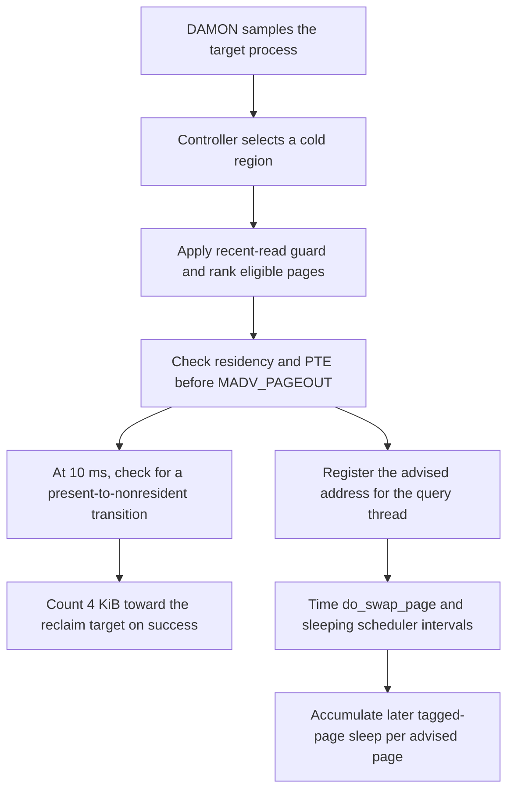
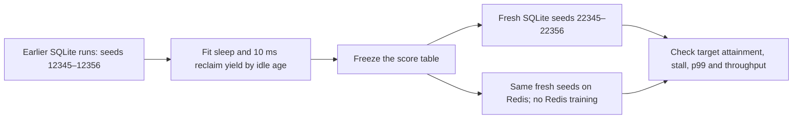

# What does it cost to reclaim 96 KiB? A Linux memory-tiering experiment on NVMe

An early SQLite benchmark gave us a striking result. Under the same memory limit, our idle-time selector freed 2.70 MB, while our least-recently-used selector freed 1.47 MB. Both completed about 33,500 queries per second. Before building a more elaborate predictor, we looked at the pages each selector had actually sent to Linux. Nearly half of LRU’s choices already had swap entries.

That observation changed the experiment. We added a filter, instrumented swap faults in the kernel, and gave each policy a byte target. The question became concrete: **can we make 24 pages nonresident while spending less of the application thread’s time waiting for those pages later?**

We tested a cost-aware policy on SQLite and Redis on an AWS Sydney `i7i.2xlarge`. It reached the target on all 24 workload–seed pairs. On SQLite its pooled stall time was 1.25% below filtered LRU, with a win on six of twelve seeds. On Redis it reached the target more reliably, while idle-only recorded the least stall on the seeds where every policy succeeded. The strongest result was reclaim reliability. A consistent latency advantage remains open. [SQLite results](../results/sydney-nvme-pilot/matched-cost/sqlite-summary.json) · [Redis results](../results/sydney-nvme-pilot/matched-cost/redis-summary.json)

## The missing denominator in an eviction benchmark

The pilot puts a cooperative process under a cgroup memory limit and uses local NVMe as swap, with zswap disabled. DAMON samples access by region. A controller chooses a cold region, and a page selector picks candidates within it. The workload excludes recently read pages with a 100 ms guard and issues `MADV_PAGEOUT` on individual 4 KiB pages. Linux decides what actually happens to each page. The LRU comparator in these experiments is the harness’s exact last-read ordering within the selected region. Stock Linux reclaim is a different comparator.

The first fault-attribution campaign tracked residency before advice and again afterward. At the 10 ms checkpoint, 359 pages selected by LRU and 660 selected by idle-only had gone from present and resident to nonresident. LRU had issued 768 requests and idle-only 752. Of those requests, 370 LRU choices already had swapped page-table entries, compared with 41 for idle-only. The ratio looks much smaller when conditioned on pages that started present: 359/398 versus 660/711. [First fault-attribution campaign](../results/sydney-nvme-pilot/swap-fault-attribution/summary.json)

We repeated the comparison with a third selector. **Filtered LRU** walks the same LRU order, skips candidates whose page-table entry is already swapped, and continues until it fills the advice budget or runs out of candidates.

| Live selector | Advice requests | Newly nonresident at 10 ms | At 100 ms | Median SQLite p99 |
|---|---:|---:|---:|---:|
| Plain LRU | 768 | 1,122,304 B | 929,792 B | 108.02 µs |
| Filtered LRU | 752 | 2,551,808 B | 2,093,056 B | 107.63 µs |
| Idle-only | 736 | 2,617,344 B | 2,093,056 B | 108.09 µs |

These are same-campaign comparisons. The filter recovered **95.6% of idle-only’s 10 ms gain** over plain LRU, calculated as (2,551,808 − 1,122,304) / (2,617,344 − 1,122,304). At 100 ms, filtered LRU and idle-only had exactly the same pooled byte count. That made filtered LRU the baseline to beat. [Five-arm campaign and per-seed metrics](../results/sydney-nvme-pilot/filtered-fault-attribution/summary.json)

## From a cold region to a measured outcome

A read soon after page-out is a useful warning signal. It does not tell us how long the application waited. In an early control, a swapped page-table entry produced a 3.681 µs fault-handler call with zero measured sleep. We needed a measurement at the fault itself.



The diagnostic kernel module instruments entry to and return from `do_swap_page`. It matches the query thread and registered virtual page, then uses scheduler switch events to time intervals when that thread slept inside the handler. The interval includes the delay until the thread runs again. Elapsed handler time, kernel swap-in delay accounting, and sleeping time are recorded separately. The policy trains on the last of these. Attribution means that a later fault concerned an advised address; it does not establish how much of the wait the advice caused. [Kernel probe](../kernel/swapfault/pmt_swapfault.c) · [Residency checks](../harness/residency_followup.py)

The positive control forced pages out under memory pressure, verified nonresidency, then reread them. All 16 registered nonresident pages triggered attributed faults; the registered resident page recorded zero. Repeating the control mattered. One early campaign silently produced zeros after probe re-registration. We discarded it, reinitialized the probe for each worker, and added a task-wide fault-activity check so a silent tracer cannot masquerade as a perfect policy. [Validation fixture](../harness/swap_trace.py) · [Repeated control output](../results/sydney-nvme-pilot/matched-cost/validation-repeat.json)

## Why predicting reuse was insufficient

In an earlier replay, a three-feature predictor used page-table state, idle time, and page range. On a capture collected while address order controlled eviction, it selected 136 pages reused within 100 ms, compared with 165 for LRU. On a fresh capture collected under live LRU, the predictor selected 157 early reuses and LRU selected 149. On the live predictor’s own capture the counts were 177 and 170. Every comparison used the same 768 selection slots within its capture. Replay reproduced all 1,536 actual choices on the two live-selector trajectories.

Two things had changed: the candidate sets the controller encountered, and what the application did afterward. Offline replay can hold both fixed for a comparison. Deploying a policy can change both. An eight-way feature ablation subsequently found that idle time alone gave the lowest aggregate early reuse. We retained it as a cheap baseline. Idle-only learns reuse risk for an age bucket; LRU sorts directly by last-read time. [Trajectory replay](../results/sydney-nvme-pilot/selector-trajectories/comparison.json) · [Feature ablation](../results/sydney-nvme-pilot/selector-trajectories/feature-ablation.json)

## What the cost-aware policy learns

The contribution we tested is an eviction rule with a measurable objective. It ranks a candidate by **expected tagged-page sleep per successful reclaim**, and stops advising once observations confirm the requested number of bytes. DAMON supplies region observations and Linux supplies eviction. PMT connects page selection, outcome attribution, and a byte-target stopping rule.

The model has one input: time since the last observed read, grouped into buckets that double from a 100 ms base, with a separate bucket for unseen pages. For bucket *b*, let *S_b* be the sum of tagged sleeping nanoseconds and *R_b* the number of successful 10 ms reclaim observations. Across all eligible training observations, let *S*, *R*, and *N* be total sleep, successes, and observation count. The score is:

```text
score(b) = (S_b + 32 × S/N) / (R_b + 32 × R/N)
```

The units are nanoseconds per successfully reclaimed page. Dividing by 4,096 would express the same ranking per byte. Zero-stall pages contribute observations, and the terms weighted by 32 stabilize sparse buckets. At selection time the policy skips swapped entries, prefers the lowest score, and breaks ties by address. The training labels come from pages earlier policies actually advised, so coverage depends on those earlier choices. Dirty history, write amplification, and flash wear are outside this model. [Training implementation](../harness/reclaim_cost.py) · [Live selector](../harness/bounded_eviction.py)



## The equal-byte test

Each workload ran 60,000 operations per seed with three selectors. All six arm orders occurred twice across the twelve seeds. A run could advise at most 16 pages per decision and 64 distinct pages overall. The target was **24 confirmed 4 KiB pages, or 98,304 bytes**. Each outstanding advice reserves a slot until the 10 ms observation arrives. A success fills the slot; a failure lets the controller try another page.

That definition matters. The experiment adds transitions observed at each individual page’s checkpoint. Pages can return later. The result measures cumulative reclaim yield; measuring sustained free memory would require a common-time residency or RSS measurement. Filtered LRU and cost-aware share the swap-entry filter, making them the cleanest ranking comparison. Idle-only keeps its original eligibility rule. [Experiment and reproduction commands](EXPERIMENT.md#reproducing-the-matched-byte-comparison)

### SQLite: fewer requests, a small pooled stall difference

SQLite ran point lookups under a 19,660,800-byte cap, half the reference calibration. The harness served database reads from a private anonymous mapping, allowing a page read to be linked to the kernel’s swap path. All three selectors reached 96 KiB on every seed. Stall is the sum across the 12 runs; p99 and throughput are medians of the per-seed values.

| Selector | Advice requests | Tagged sleep | Median p99 | Median queries/s |
|---|---:|---:|---:|---:|
| Filtered LRU | 309 | 37.45 ms | 100.19 µs | 33,470 |
| Idle-only | 352 | 39.09 ms | 100.95 µs | 33,839 |
| Cost-aware | 296 | 36.98 ms | 100.95 µs | 33,692 |

Cost-aware used 13 fewer advice requests than filtered LRU to reach the same target. The pooled saving was 0.47 ms over 720,000 queries. Pair the seeds and cost-aware had less stall on six of twelve against each baseline. Seed 22351 illustrates the sensitivity: removing that seed **from both sides** leaves idle-only at 32.77 ms and cost-aware at 33.93 ms. All twelve belong in the headline result. The sensitivity check explains why the pooled ordering alone is weak evidence of a speedup. [SQLite raw records](../results/sydney-nvme-pilot/matched-cost/sqlite.json.gz)

### Redis: the frozen model transferred, with a different tradeoff

Redis 7.0.15 ran native server-side `GETRANGE` calls against one 32 MiB string, alternating uniform page offsets and a 64-page hot set. The separately calibrated cap was 28,086,272 bytes. The driver verified every reply. Timings include the embedded cooperative driver and exclude client network time. This is one Redis access pattern, with the same score table trained on SQLite. [Redis benchmark driver](../harness/redis_cost/redis_worker.py)

| Selector | Seeds reaching target | Tagged sleep, all 12 | Tagged sleep, matched 9 | Median p99, all 12 | Median ops/s, all 12 |
|---|---:|---:|---:|---:|---:|
| Filtered LRU | 11/12 | 33.43 ms | 22.78 ms | 86.53 µs | 50,053 |
| Idle-only | 10/12 | 26.64 ms | 19.99 ms | 86.49 µs | 53,165 |
| Cost-aware | 12/12 | 28.36 ms | 21.26 ms | 86.37 µs | 50,957 |

Across all twelve seeds the arms reclaimed different byte totals, so their total sleep answers a different question from stall at equal reclaim. Nine seeds met the target under every selector. Within those nine, cost-aware fell between the baselines. The other three are part of the result: idle-only missed the target on seeds 22348 and 22352; filtered LRU exhausted its 64-page advice allowance on seed 22356. Reporting only the nine would hide the most useful transfer result. [Redis raw records](../results/sydney-nvme-pilot/matched-cost/redis.json.gz)

## What I would carry into the next experiment

**Keep filtered LRU as the baseline.** It is inexpensive to explain, removed most of the apparent gain from prediction, and reached essentially the same SQLite p99 as the learned policies. **Keep target attainment and stall as separate outcomes.** The frozen model reached 96 KiB in every workload–seed pair; the data do not establish consistently lower stall at that target. This was a small Sydney NVMe pilot, with cooperative access histories and limited workload shapes. A general-purpose kernel reclaim policy and a performance win over stock Linux remain separate claims.

The next discriminating test would hold eligibility and the byte target fixed, change the workload shape or target size, and add one pre-advice feature with a reason to predict fault cost. A useful result would be a paired reduction in stall that survives both a fresh workload and the filtered-LRU control. The experiment now has a way to measure it.

**Evidence snapshot:** benchmark code and data through commit `bbc30a2`. The two fresh-seed campaigns contain 72 runs. To audit either table, run the checked-in summarizer against the compressed raw file, then inspect the per-seed entries alongside the aggregate. [Aggregation code](../harness/summarize_cost.py) · [Experiment protocol](EXPERIMENT.md)
